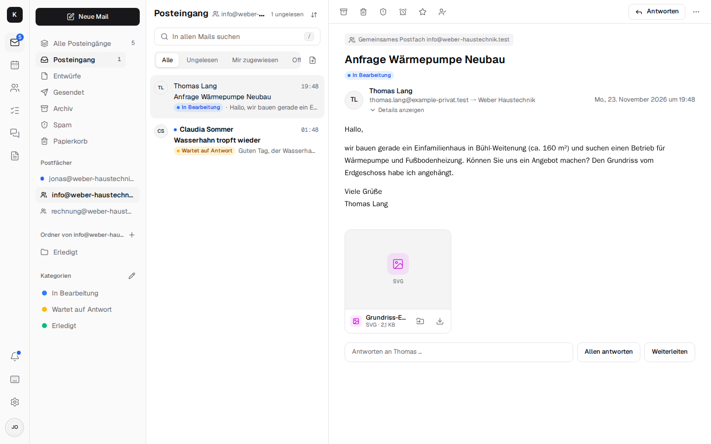
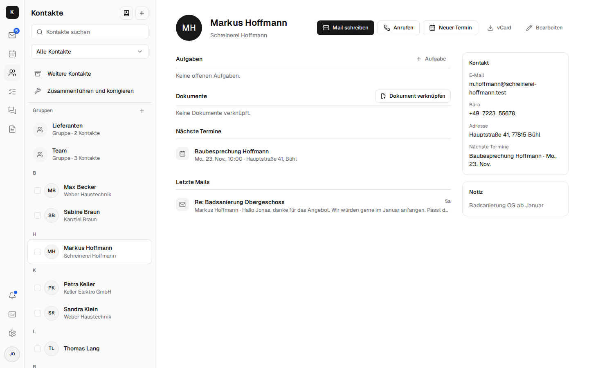
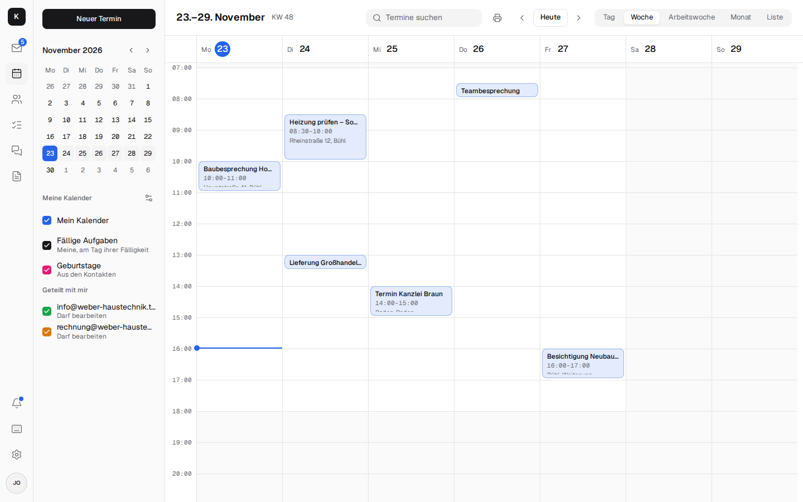
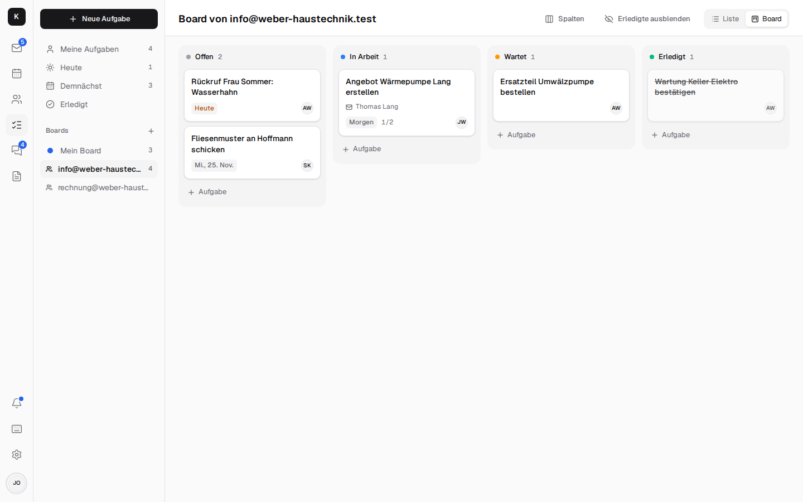
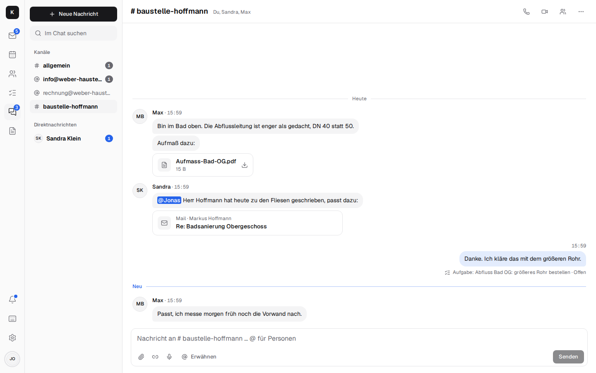
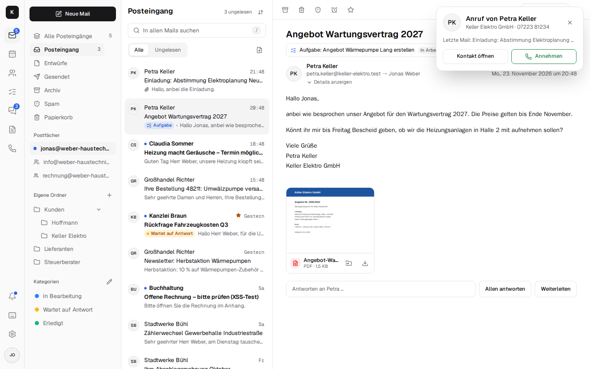
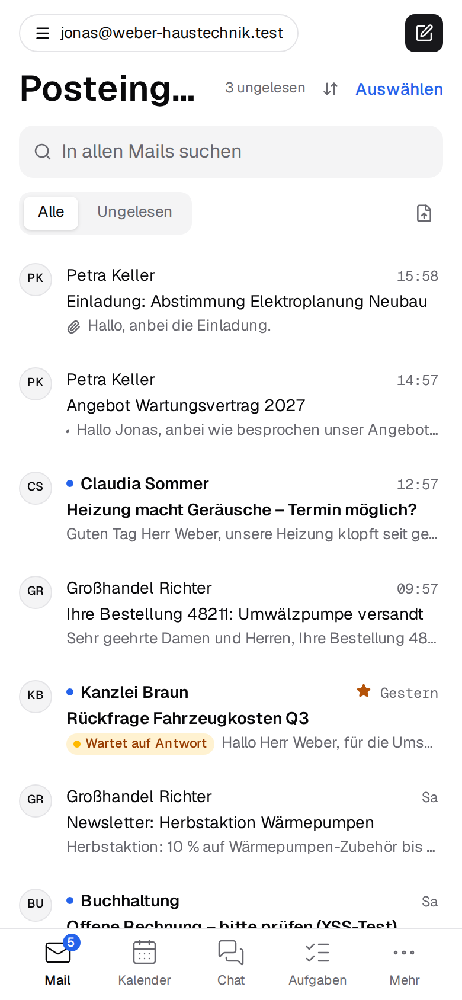
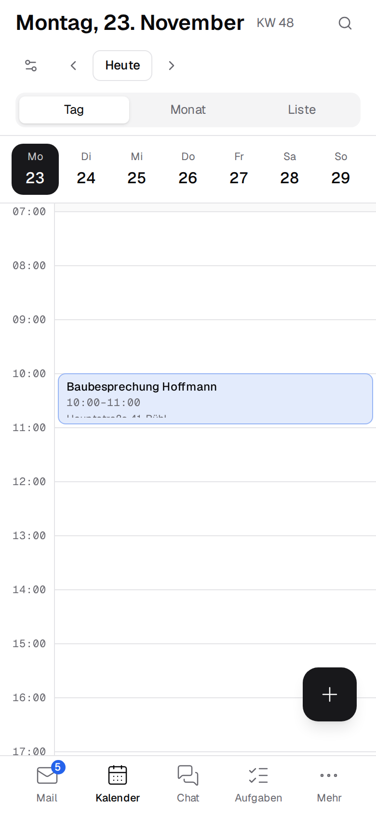
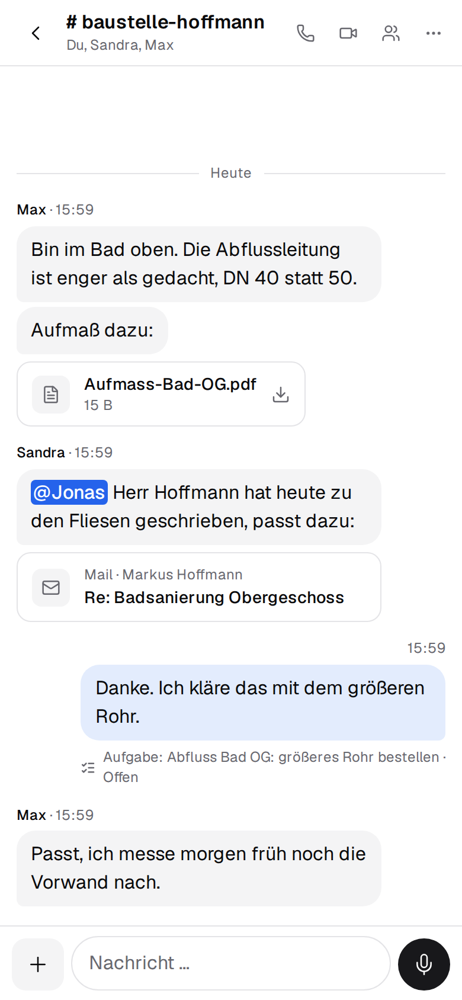

<div align="center">

<h1>Kontext – deine eigene Alternative zu Google Workspace und Microsoft 365</h1>

<a href="https://kontext.email/"></a>

**Mail, Kalender, Chat, Dokumente und Telefon für dein Team – auf deinem eigenen Server, Open Source**<br>
Ohne Kosten pro Benutzer. Made in Europe.

[](https://github.com/firsttris/kontext/actions/workflows/ci.yml)
[](https://github.com/firsttris/kontext/releases/latest)
[](https://hub.docker.com/r/tristanteu/kontext)
[](https://hub.docker.com/r/tristanteu/kontext/tags)
[](https://kontext.email/)
[](LICENSE)
[](https://stalw.art)
[](https://jmap.io)
[](#-warum-kontext)
[](#-warum-kontext)
[](https://www.typescriptlang.org)
[](https://bun.sh)
[](https://react.dev)
[](https://tanstack.com)
[](https://tailwindcss.com)
[](https://vite.dev)
[](https://hono.dev)
[](https://orm.drizzle.team)
[](https://kontext.email/agents.html)

[Warum](#-warum-kontext) •
[Installation](#-installation) •
[Funktionen](#-funktionen) •
[Screenshots](#-screenshots) •
[Alternativen](#-kontext-und-die-alternativen) •
[FAQ](#-faq) •
[Dokumentation](https://kontext.email/) •
[English](README.md)

▶️ **[Film ansehen (2 Min.)](https://kontext.email/)** · 🖱️ **[Demo ausprobieren](https://kontext.email/demo/)** – im Browser, ohne Installation

</div>

## 💡 Warum Kontext?

Google Workspace und Microsoft 365 sind bequem, aber jeder Benutzer kostet jeden Monat, und die
Daten liegen bei einem US-Konzern. Kontext fühlt sich im Browser und am Handy genauso an, läuft
aber auf **deinem** Server: einem kleinen VPS ab etwa 5 € im Monat (z. B. bei IONOS oder Hetzner)
oder einem eigenen Rechner.

- **Deine Daten bleiben bei dir**: Mails, Termine, Kontakte, Chat und Anrufe liegen auf deinem
  Server, in Europa oder im eigenen Büro. Kein US-Anbieter dazwischen, keine Tracker.
- **Keine Kosten pro Kopf**: Zehn Mitarbeiter kosten dasselbe wie einer; bezahlt wird der Server.
- **Alles zum Kunden an einem Ort**: seine letzten Mails, nächsten Termine, offenen Aufgaben und
  Anrufe – ein kleines CRM ohne Extra-Tool.
- **Eine App statt fünf**: Mail, Kalender, Aufgaben, Team-Chat mit Videocalls, das Firmentelefon
  und Dokumente, mit einer Anmeldung.
- **Für Handy und Tastatur gebaut**: Jede Ansicht funktioniert am Handy und ohne Maus, und Kontext
  lässt sich ohne App Store als App installieren.
- **KI, wenn du willst**: Claude und andere Assistenten finden Kunden, Mails und Termine für dich
  und schreiben Entwürfe – sie senden und löschen nie etwas.
- **Offen, kein Lock-in**: Open Source (AGPL) und Standardprotokolle, damit Outlook, Thunderbird,
  iPhone und Android weiter funktionieren und du jederzeit alles mitnehmen kannst.

## 🚀 Installation

Du brauchst einen Server mit Docker oder Podman, eine eigene Domain und offene Ports für Mail und
Web (25, 80, 443, 465, 587, 993). Für zehn Benutzer reicht ein VPS mit 2 vCPU und 4 GB RAM.

**Mit einem Agenten:** Gib Claude Code oder einem anderen Coding-Agenten dieses Repository und
SSH-Zugang zu deinem Server und sag: „Setz Kontext auf meinem Server auf, nach der
[Installationsanleitung](https://kontext.email/installation.html).“

**Von Hand:**

```bash
git clone https://github.com/firsttris/kontext /opt/kontext && cd /opt/kontext
cp deploy/.env.example deploy/.env && chmod 600 deploy/.env
nano deploy/.env                              # Domain, Version, Backup-Ziel, jedes change-me ersetzen
docker compose -f deploy/compose.yaml up -d   # lädt Kontext, Stalwart und Caddy und startet sie
```

Danach Stalwart einrichten (Domain, DKIM, das Konto des Chefs) und Kontext mit einem Befehl dort
eintragen. Diese Schritte, DNS, Telefonie, Backups und Updates stehen in der
[Installationsanleitung](https://kontext.email/installation.html); für einen frischen Server
gibt es die Seite [VPS einrichten](https://kontext.email/vps.html).

## ✨ Funktionen

Kurz je Bereich; die Details stehen auf der verlinkten Seite der [Dokumentation](https://kontext.email/ueberblick.html).

| Bereich | Was Kontext kann |
|---|---|
| ✉️ [Mail](https://kontext.email/mail.html) | Gemeinsame Postfächer wie info@, Mails zuweisen, Vertretung, Regeln und Kategorien, Suche auch in Anhängen, maskierte Adressen |
| 📅 [Kalender](https://kontext.email/calendar-contacts.html) | Team-Kalender, Einladungen mit einem Klick beantworten, „Wer hat Zeit?“, Videobesprechung pro Termin |
| 👥 [Kontakte](https://kontext.email/calendar-contacts.html#kontakte) | Der Kunde auf einen Blick: letzte Mails, nächste Termine, offene Aufgaben und Anrufe |
| ✅ [Aufgaben](https://kontext.email/tasks.html) | Liste oder Kanban-Board pro Postfach, aus Mail, Chat, Termin oder verpasstem Anruf |
| 💬 [Team-Chat & Video](https://kontext.email/chat.html) | Kanäle und Direktnachrichten, Mails als Karten, Videocalls und Bildschirm teilen auf dem eigenen Server |
| 📞 [Telefonie (CTI)](https://kontext.email/telephony.html) | Fritzbox und Nummern bleiben, Anrufe klingeln mit dem Kontakt des Anrufers, Anrufen per Klick |
| 🔐 [Verschlüsselung](https://kontext.email/encryption.html) | OpenPGP und S/MIME, vertraulich senden an jeden, verschlüsselter Speicher und Backups |
| 📄 [Dokumente](https://kontext.email/documents.html) | Word, Excel, PowerPoint und PDF im Browser mit [Schreibzeug](https://github.com/firsttris/schreibzeug) |
| 🤖 [KI-Agenten (MCP)](https://kontext.email/agents.html) | Claude und andere Agenten schlagen mit deinen Rechten nach und schreiben Entwürfe |
| 🏢 [Firmenverwaltung](https://kontext.email/company.html) | Mitarbeiter, Postfächer und Rechte ohne IT-Kenntnisse, Firmen-Signatur, Umzug von Microsoft 365 und Gmail |
| 📱 [Auf jedem Gerät](https://kontext.email/app.html) | App ohne App Store, Push-Benachrichtigungen, Passkeys, hell und dunkel |
| ♿ [Barrierefreiheit](https://kontext.email/accessibility.html) | Alles per Tastatur, bei jedem Push gegen WCAG 2.2 AA geprüft |

## 📸 Screenshots

<table>
  <tr>
    <td width="50%"><br><sub><b>Gemeinsames Postfach</b> – info@ fürs ganze Team</sub></td>
    <td width="50%"><br><sub><b>Kontakte</b> – der Kunde auf einen Blick</sub></td>
  </tr>
  <tr>
    <td><br><sub><b>Kalender</b> – Woche, Monat, Verfügbarkeit</sub></td>
    <td><br><sub><b>Aufgaben</b> – ein Kanban-Board pro Postfach</sub></td>
  </tr>
  <tr>
    <td><br><sub><b>Team-Chat</b> – Mails als Karten, Aufgaben aus Nachrichten</sub></td>
    <td><br><sub><b>Telefonie</b> – der Anrufer mit seiner letzten Mail</sub></td>
  </tr>
</table>

<p align="center">
  
  
  
  
</p>

Mehr Bilder, gemacht zum Weiterschicken an Kunden, im [Rundgang](https://kontext.email/).

## 🔀 Kontext und die Alternativen

| | Was es ist | Was Kontext anders macht |
| --- | --- | --- |
| [Google Workspace](https://workspace.google.com), [Microsoft 365](https://www.microsoft.com/microsoft-365) | Mail, Kalender und Office im Abo pro Benutzer | eigener Server, keine Kosten pro Kopf, Chat und Telefon inklusive |
| [Nextcloud](https://nextcloud.com) | selbst gehostete Dateien, Mail und Kalender als Apps | um Mail und den Kunden herum gebaut, mit gemeinsamen Postfächern und Firmentelefon |
| [Roundcube](https://roundcube.net), [SOGo](https://www.sogo.nu) | bewährte Webmailer für IMAP | moderne Oberfläche fürs Handy, Kundenansicht, Aufgaben und Chat |
| [Zimbra](https://www.zimbra.com), [Open-Xchange](https://www.open-xchange.com) | Groupware für Provider und größere Firmen | ein kleiner Server pro Firma, an einem Nachmittag eingerichtet |
| [3CX](https://www.3cx.com), [Placetel](https://www.placetel.de) | Telefonanlagen mit CTI-Apps | Fritzbox und Nummern bleiben, keine Lizenz pro Nebenstelle |

## ❓ FAQ

<details>
<summary><b>Für wen ist Kontext gedacht?</b></summary>

Für kleine Betriebe, die den Komfort von Google Workspace auf dem eigenen Server wollen:
Selbstständige, Handwerk, Kanzleien und Praxen, kleine und mittlere Betriebe. Dazu für Selfhoster,
die eine Weboberfläche für den Mailserver [Stalwart](https://stalw.art) suchen: Kontext ist ein
JMAP-Client für Mail, Kalender und Kontakte auf Stalwart, siehe
[Architektur](https://kontext.email/architecture.html).
</details>

<details>
<summary><b>Was kostet das?</b></summary>

Die Software ist kostenlos (AGPL). Du brauchst einen Server – einen VPS ab etwa 5 € im Monat – und
jemanden, der ihn einrichtet und aktuell hält.
</details>

<details>
<summary><b>Stalwart Community oder Enterprise?</b></summary>

Kontext läuft vollständig mit der kostenlosen Community-Ausgabe von Stalwart. Mit einer
Enterprise-Lizenz kommt einiges dazu, etwa gelöschte Mails wiederherstellen und die Anmeldung über
das Firmenkonto (SSO), siehe [Stalwart Enterprise](https://kontext.email/installation.html#stalwart-enterprise).
</details>

<details>
<summary><b>Funktioniert Kontext mit meiner Fritzbox (CTI)?</b></summary>

Ja. Eine Telefonbox im Büro meldet sich an der Fritzbox als IP-Telefon an; Anrufe klingeln dann in
Kontext mit Kontakt und letzter Mail des Anrufers. Siehe [Telefonie](https://kontext.email/telephony.html).
</details>

<details>
<summary><b>Läuft das auf meinem eigenen PC oder NAS?</b></summary>

Ja, überall, wo Docker oder Podman läuft. Um Mails aus dem Internet zu empfangen, braucht der
Rechner aber Port 25 von außen, eine feste IP-Adresse und einen Reverse-DNS-Eintrag; private
Internetanschlüsse sperren Port 25 meist. Ein kleiner VPS ist darum einfacher.
</details>

<details>
<summary><b>Hilft Kontext bei der DSGVO?</b></summary>

Ja, mit dem, was die Software beitragen kann: Die Daten bleiben auf deinem Server, ohne Tracker
und ohne Dritte. Die DSGVO selbst setzt aber deine Firma um, etwa mit dem
Auftragsverarbeitungsvertrag mit deinem Hoster und dem Verzeichnis der Verarbeitungstätigkeiten.
</details>

<details>
<summary><b>Funktionieren iPhone, Android, Outlook und Thunderbird weiter?</b></summary>

Ja. Stalwart spricht IMAP, SMTP, CalDAV und CardDAV; jedes Mailprogramm und Handy kann sich direkt
verbinden. Kontext ist die Oberfläche im Browser obendrauf.
</details>

<details>
<summary><b>Kann ich von Gmail, Microsoft 365 oder Outlook umziehen?</b></summary>

Ja: IMAP-Postfächer, Microsoft 365, Outlook als PST-Datei und Kontakte und Kalender aus dem
Google-Export. Eine bestehende Gmail-Adresse kannst du auch weiter nutzen. Siehe
[Firmenverwaltung und Umzug](https://kontext.email/company.html).
</details>

<details>
<summary><b>Kann ich Claude oder andere KI-Agenten mit meinen Mails nutzen?</b></summary>

Ja, über MCP: Claude und andere Agenten schlagen mit deinen Rechten nach, schreiben Entwürfe und
laden Kollegen zu Terminen ein; nach draußen schicken und löschen sie nie etwas. Siehe
[KI-Agenten](https://kontext.email/agents.html).
</details>

<details>
<summary><b>Welche Sprachen?</b></summary>

Deutsch und Englisch, je Gerät umstellbar. Weitere europäische Sprachen sind geplant.
</details>

<details>
<summary><b>Ist das sicher?</b></summary>

Wir prüfen automatisiert, und du kannst es auch: Der Code ist offen. Ein unabhängiges Audit gibt es bisher nicht.

- **Automatisiert geprüft:** mit Cloudflares [Security Audit Skill](https://github.com/cloudflare/security-audit-skill) und
  `/security-review` von Claude Code. Lass deinen Agenten gern selbst über dieses Repository laufen.
- **Abgesichert:** Der Browser hält nur ein httpOnly-Cookie, die Stalwart-Tokens liegen verschlüsselt
  auf dem Server; Stalwarts Speicher ist verschlüsselt, Backups gehen verschlüsselt und unveränderbar
  (Object Lock) auf S3-Speicher; Bilder aus dem Internet lädt eine Mail erst auf Wunsch; KI-Agenten
  schicken nie etwas nach draußen und löschen nichts.
- **Aktuell gehalten:** Renovate bringt Updates der Abhängigkeiten als Pull Request durch die CI; bekannte Lücken
  (Dependabot-Warnungen und OSV-Datenbank) behebt es außerhalb des Zeitplans, siehe
  [SECURITY.md](SECURITY.md#keeping-dependencies-up-to-date).
- **Offen für alle:** Jeder kann den Code lesen und Lücken melden, bitte vertraulich wie in [SECURITY.md](SECURITY.md)
  beschrieben.
</details>

<details>
<summary><b>Wird Kontext mit KI entwickelt?</b></summary>

Ja, zu einem großen Teil mit Coding-Agenten, aber nicht ungeprüft: Jede Änderung bringt Tests mit
(Unit-Tests und Playwright am Desktop und am Handy), und die CI prüft sie gegen einen echten
Stalwart. Wie gebaut und getestet wird, steht unter
[Entwicklung](https://kontext.email/development.html).
</details>

## 📚 Dokumentation

Alles im Detail, mit Suche: **[kontext.email](https://kontext.email/)** ([English](https://kontext.email/en/)).
Jede Funktion oben verlinkt ihre Seite; dazu kommen:

- **Einstieg:** [Rundgang in Bildern](https://kontext.email/) (zum Weiterschicken an Kunden),
  [alle Funktionen](https://kontext.email/ueberblick.html), [Installation](https://kontext.email/installation.html)
  und [VPS einrichten](https://kontext.email/vps.html)
- **Hintergrund:** [Architektur](https://kontext.email/architecture.html),
  [Entwicklung](https://kontext.email/development.html), [Changelog](CHANGELOG.md) (Englisch) und
  [Roadmap](ROADMAP.de.md)

## 🛠️ Entwicklung

Benötigt [Bun](https://bun.sh) 1.4 und Linux oder macOS (Windows über WSL).

```bash
git clone https://github.com/firsttris/kontext && cd kontext
bun install
bun run dev   # Stalwart mit Testdaten, Server und App: http://localhost:5173
```

Anmelden als `jonas@weber-haustechnik.test` / `kaffee-werkbank-kontext` (der Chef, sieht auch die
Firmenverwaltung); `anna@`, `sandra@` und `max@` haben dasselbe Passwort. Aufbau, Tests und
Releases: [Entwicklung](https://kontext.email/development.html).

## 🧩 Mehr von uns

- Word, Excel und PowerPoint ohne Microsoft 365? **[Schreibzeug](https://github.com/firsttris/schreibzeug)** bearbeitet sie im Browser und speichert sie als .docx, .xlsx und .pptx.
- Machst du deine Buchhaltung selbst? **[Haben](https://github.com/firsttris/haben)**: Rechnungen mit E-Rechnung, Belege, Bankabgleich und die Umsatzsteuer-Voranmeldung an ELSTER.

## 🤝 Mitmachen

Fehler und Ideen gern als Issue, mit dem [Formular für Fehlerberichte](https://github.com/firsttris/kontext/issues/new?template=bug_report.yml).
Sicherheitslücken bitte vertraulich melden, siehe [SECURITY.md](SECURITY.md). Was vor einem Pull
Request laufen muss, steht in [CONTRIBUTING.md](CONTRIBUTING.md).

---

<div align="center">

⭐ Gefällt dir Kontext? Ein [Stern auf GitHub](https://github.com/firsttris/kontext) hilft anderen, es zu finden.<br>
🐛 [Fehler melden](https://github.com/firsttris/kontext/issues/new?template=bug_report.yml) · 💡 [Idee vorschlagen](https://github.com/firsttris/kontext/issues/new?template=feature_request.yml)

<sub>Lizenz: <a href="LICENSE">AGPL-3.0</a> · © Tristan Teufel und Mitwirkende · <a href="README.md">English version</a><br>
Wer eine veränderte Version weitergibt oder für andere betreibt, muss ihren Quellcode unter der AGPL anbieten; eine kommerzielle Lizenz ohne diese Pflichten gibt es über <a href="https://teufel-it.de">teufel-it.de</a>.<br>
Kontext ist keine Rechtsberatung: Datenschutz und Aufbewahrungspflichten setzt die Firma um, die Software unterstützt dabei.<br>
Kontext steht in keiner Verbindung zu Stalwart Labs, AVM (FRITZ!Box), Snom, Google, Microsoft oder Anthropic.</sub>

</div>
