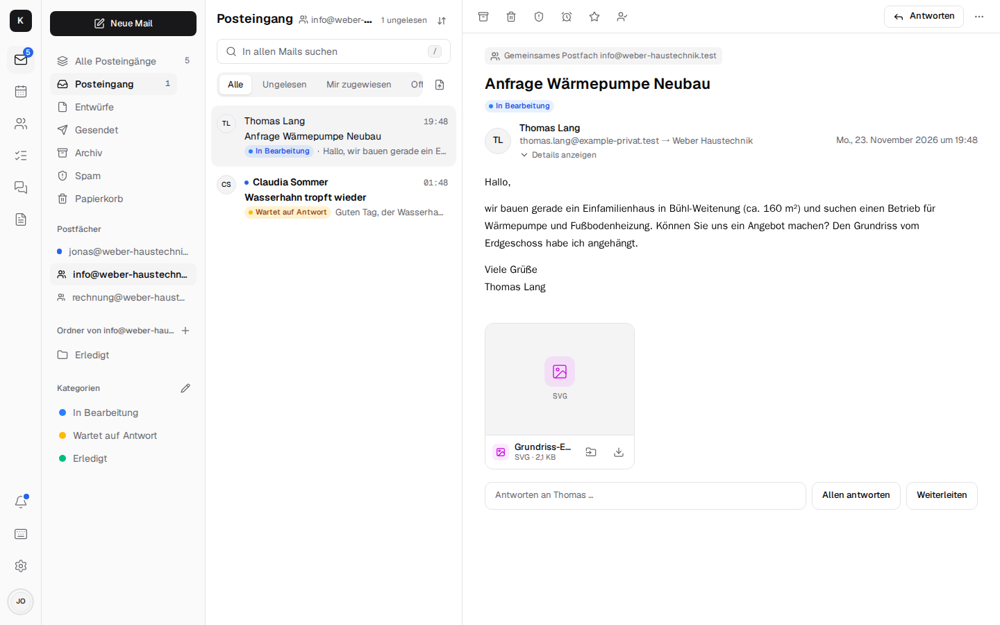
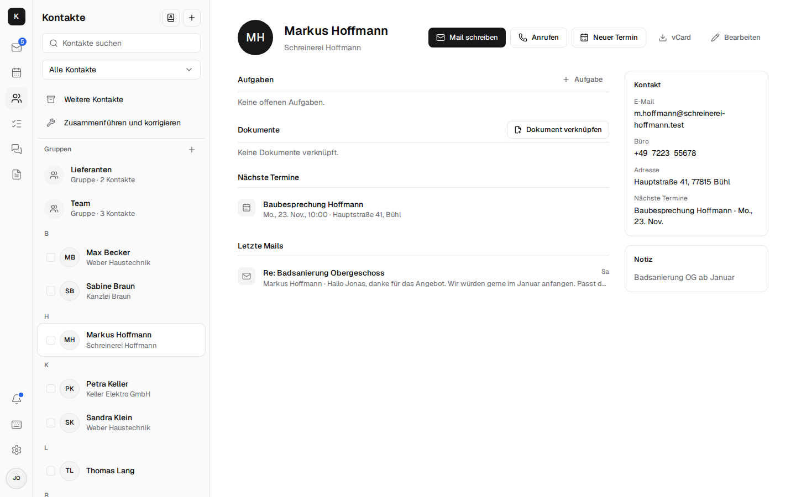
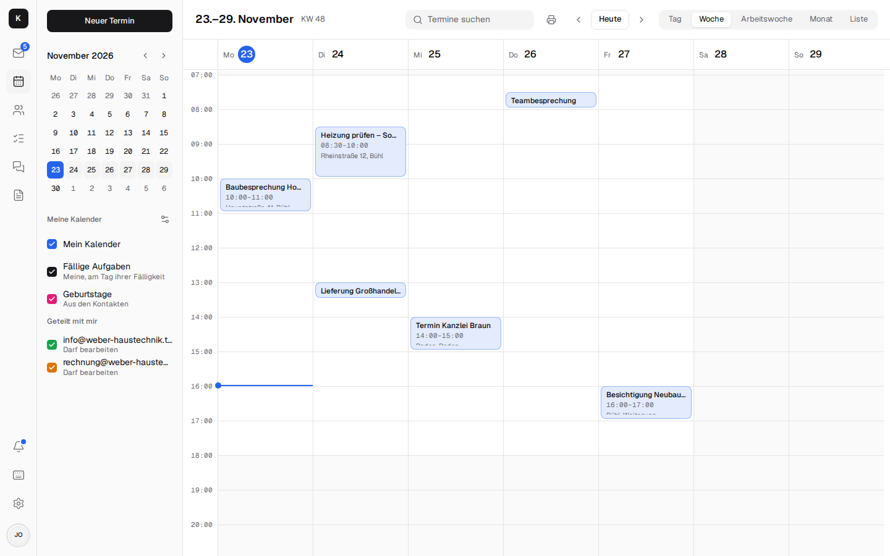
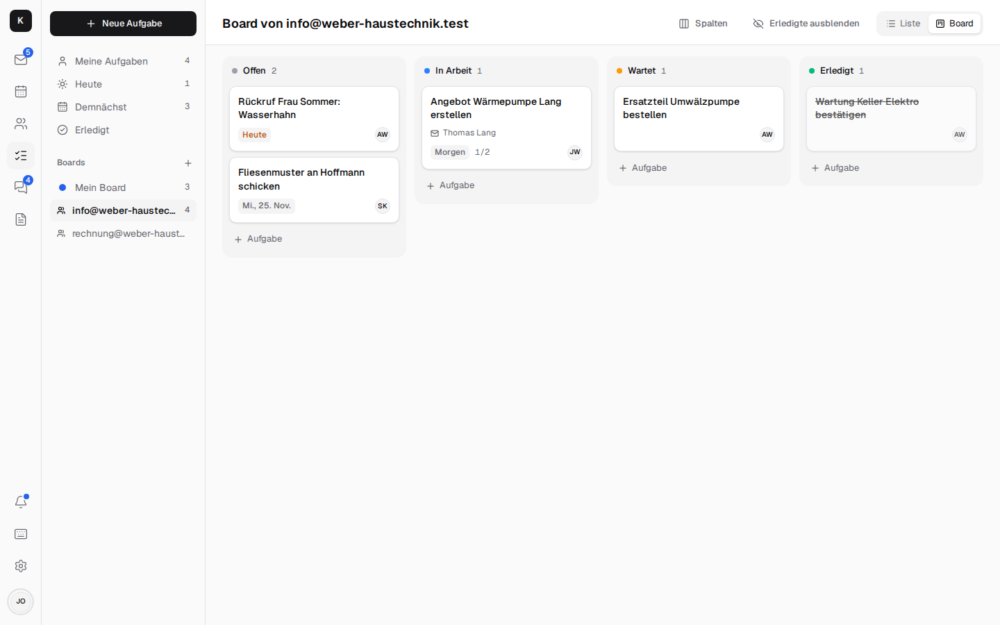
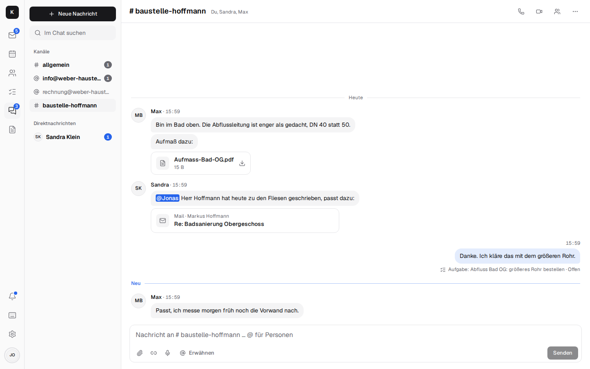
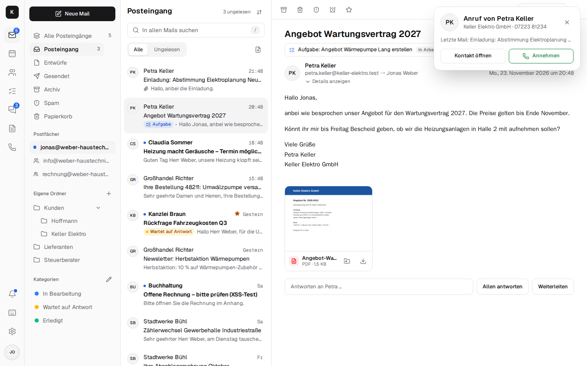
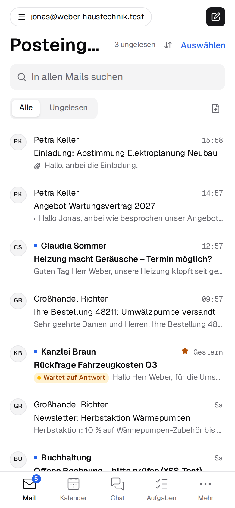
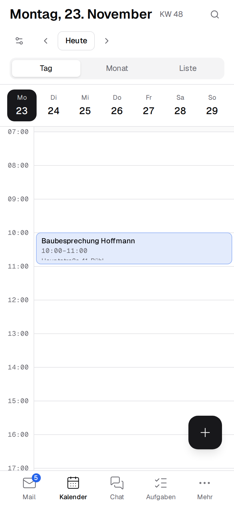
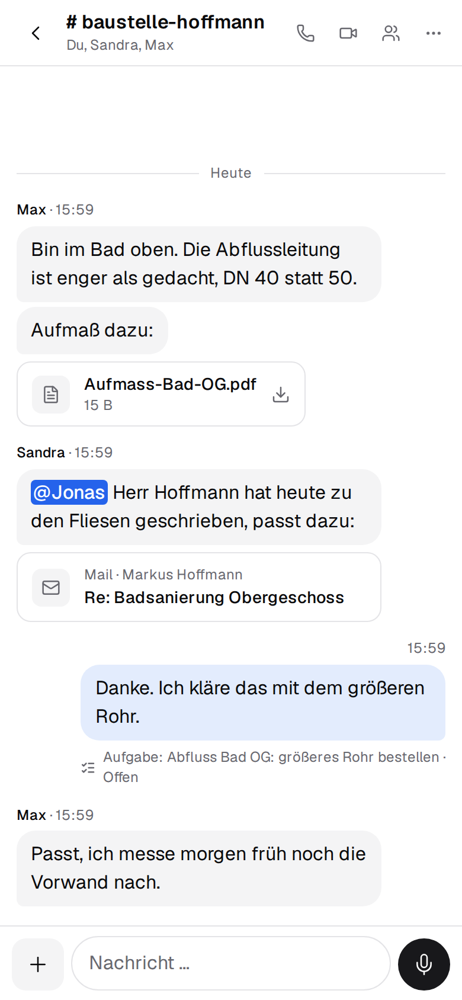

<div align="center">

<h1>Kontext – your own alternative to Google Workspace and Microsoft 365</h1>

<a href="https://kontext.email/en/"></a>

**Mail, calendar, chat, documents and phone for your team – on your own server, open source**<br>
No per-seat pricing. Made in Europe.

[](https://github.com/Speicherstadt/kontext/actions/workflows/ci.yml)
[](https://github.com/Speicherstadt/kontext/releases/latest)
[](https://hub.docker.com/r/tristanteu/kontext)
[](https://hub.docker.com/r/tristanteu/kontext/tags)
[](https://kontext.email/en/)
[](LICENSE)
[](https://stalw.art)
[](https://jmap.io)
[](#-why-kontext)
[](#-why-kontext)
[](https://www.typescriptlang.org)
[](https://bun.sh)
[](https://react.dev)
[](https://tanstack.com)
[](https://tailwindcss.com)
[](https://vite.dev)
[](https://hono.dev)
[](https://orm.drizzle.team)
[](https://kontext.email/en/agents.html)

[Why](#-why-kontext) •
[Install](#-install) •
[Features](#-features) •
[Screenshots](#-screenshots) •
[Alternatives](#-kontext-and-the-alternatives) •
[FAQ](#-faq) •
[Documentation](https://kontext.email/en/) •
[Deutsch](README.de.md)

▶️ **[Watch the film (2 min)](https://kontext.email/en/)** · 🖱️ **[Try the demo](https://kontext.email/demo/)** – in your browser, nothing to install

</div>

## 💡 Why Kontext?

Google Workspace and Microsoft 365 are convenient, but every user costs money every month and the
data sits with a US corporation. Kontext is just as convenient in the browser and on the phone, but
runs on **your** server: a small VPS from about €5 a month (e.g. at IONOS or Hetzner) or a machine
of your own.

- **Your data stays with you**: mails, appointments, contacts, chat and calls live on your server,
  in Europe or in your own office. No US provider in between, no trackers.
- **No per-seat pricing**: ten people cost the same as one; you pay for the server.
- **Everything about a customer in one place**: their latest mails, next appointments, open tasks
  and calls – a small CRM without another tool.
- **One app instead of five**: mail, calendar, tasks, team chat with video calls, the office phone
  and documents, with one sign-in.
- **Built for the phone and the keyboard**: every view works on the phone and without a mouse, and
  it installs as an app without an app store.
- **AI if you want it**: Claude and other assistants find customers, mails and appointments for you
  and write drafts – they never send or delete anything.
- **Open, no lock-in**: open source (AGPL) and standard protocols, so Outlook, Thunderbird, iPhone
  and Android keep working and you can take everything with you.

## 🚀 Install

You need a server with Docker or Podman, your own domain and open ports for mail and web (25, 80,
443, 465, 587, 993). Ten users run fine on a VPS with 2 vCPUs and 4 GB RAM.

**With an agent:** give Claude Code or another coding agent this repository and SSH access to your
server and say: "Set up Kontext on my server following the
[installation guide](https://kontext.email/en/installation.html)."

**By hand:**

```bash
git clone https://github.com/Speicherstadt/kontext /opt/kontext && cd /opt/kontext
cp deploy/.env.example deploy/.env && chmod 600 deploy/.env
nano deploy/.env                              # domain, version, backup target, replace every change-me
docker compose -f deploy/compose.yaml up -d   # pulls Kontext, Stalwart and Caddy and starts them
```

Then set up Stalwart (domain, DKIM, the boss's account) and register Kontext there with one
command. These steps, DNS, telephony, backups and updates are in the
[installation guide](https://kontext.email/en/installation.html); for a fresh server see
[setting up a VPS](https://kontext.email/en/vps.html).

## ✨ Features

In short per area; the details are on the linked page of the [documentation](https://kontext.email/en/ueberblick.html).

| Area | What Kontext does |
|---|---|
| ✉️ [Mail](https://kontext.email/en/mail.html) | Shared mailboxes like info@, assigning mails, deputies, rules and categories, search inside attachments, masked addresses |
| 📅 [Calendar](https://kontext.email/en/calendar-contacts.html) | Team calendar, invitations answered with one click, "who is free?", a video meeting per event |
| 👥 [Contacts](https://kontext.email/en/calendar-contacts.html#kontakte) | The customer at a glance: latest mails, next appointments, open tasks and calls |
| ✅ [Tasks](https://kontext.email/en/tasks.html) | List or Kanban board per mailbox, from a mail, a chat message, an appointment or a missed call |
| 💬 [Team chat & video](https://kontext.email/en/chat.html) | Channels and direct messages, mails as cards, video calls and screen sharing on your own server |
| 📞 [Telephony (CTI)](https://kontext.email/en/telephony.html) | Your Fritzbox and numbers stay, calls ring with the caller's contact, click to call |
| 🔐 [Encryption](https://kontext.email/en/encryption.html) | OpenPGP and S/MIME, send confidentially to anyone, encrypted storage and backups |
| 📄 [Documents](https://kontext.email/en/documents.html) | Word, Excel, PowerPoint and PDF in the browser with [Schreibzeug](https://github.com/Speicherstadt/schreibzeug) |
| 🤖 [AI agents (MCP)](https://kontext.email/en/agents.html) | Claude and other agents look things up with your rights and write drafts |
| 🏢 [Company admin](https://kontext.email/en/company.html) | People, mailboxes and rights without IT skills, company signature, moving in from Microsoft 365 and Gmail |
| 📱 [On every device](https://kontext.email/en/app.html) | An app without an app store, push notifications, passkeys, light and dark |
| ♿ [Accessibility](https://kontext.email/en/accessibility.html) | Everything by keyboard, checked against WCAG 2.2 AA on every push |

## 📸 Screenshots

<table>
  <tr>
    <td width="50%"><br><sub><b>Shared mailbox</b> – info@ for the whole team</sub></td>
    <td width="50%"><br><sub><b>Contacts</b> – the customer at a glance</sub></td>
  </tr>
  <tr>
    <td><br><sub><b>Calendar</b> – week, month, availability</sub></td>
    <td><br><sub><b>Tasks</b> – a Kanban board per mailbox</sub></td>
  </tr>
  <tr>
    <td><br><sub><b>Team chat</b> – mails as cards, tasks from messages</sub></td>
    <td><br><sub><b>Telephony</b> – the caller with their last mail</sub></td>
  </tr>
</table>

<p align="center">
  
  
  
  
</p>

More pictures, made to send to customers, in the [tour](https://kontext.email/en/).

## 🔀 Kontext and the alternatives

| | What it is | How Kontext differs |
| --- | --- | --- |
| [Google Workspace](https://workspace.google.com), [Microsoft 365](https://www.microsoft.com/microsoft-365) | mail, calendar and office as a per-user subscription | your own server, no per-seat cost, chat and phone included |
| [Nextcloud](https://nextcloud.com) | self-hosted files with mail and calendar as apps | built around mail and the customer, with shared mailboxes and the office phone |
| [Roundcube](https://roundcube.net), [SOGo](https://www.sogo.nu) | proven webmail clients for IMAP | modern interface built for the phone, customer view, tasks and chat |
| [Zimbra](https://www.zimbra.com), [Open-Xchange](https://www.open-xchange.com) | groupware for providers and larger companies | one small server per company, set up in an afternoon |
| [3CX](https://www.3cx.com), [Placetel](https://www.placetel.de) | phone systems with CTI apps | keeps your Fritzbox and numbers, no licence per extension |

## ❓ FAQ

<details>
<summary><b>Who is Kontext for?</b></summary>

For small businesses that want Google Workspace comfort on their own server: freelancers, trades,
law firms and medical practices, small and mid-sized businesses. And for self-hosters looking for a
web interface for the [Stalwart](https://stalw.art) mail server: Kontext is a JMAP client for mail,
calendar and contacts on Stalwart, see the [architecture](https://kontext.email/en/architecture.html).
</details>

<details>
<summary><b>What does it cost?</b></summary>

The software is free (AGPL). You need a server – a VPS from about €5 a month – and someone who
sets it up and keeps it updated.
</details>

<details>
<summary><b>Stalwart Community or Enterprise?</b></summary>

Kontext runs fully on Stalwart's free Community edition. An Enterprise license adds a few things,
such as restoring deleted mails and sign-in with the company account (SSO), see
[Stalwart Enterprise](https://kontext.email/en/installation.html#stalwart-enterprise).
</details>

<details>
<summary><b>Does Kontext work with my Fritzbox (CTI)?</b></summary>

Yes. A telephone box in the office registers as an IP phone at the Fritzbox; calls then ring in
Kontext with the caller's contact and last mail. See [Telephony](https://kontext.email/en/telephony.html).
</details>

<details>
<summary><b>Can it run on my own PC or NAS?</b></summary>

Yes, wherever Docker or Podman runs. To receive mail from the internet the machine needs port 25
reachable from outside, a fixed IP address and a reverse DNS entry; home internet connections
usually block port 25. A small VPS is simpler.
</details>

<details>
<summary><b>Does Kontext help with the GDPR?</b></summary>

Yes, with what software can do: the data stays on your server, without trackers or third parties.
The GDPR itself is up to your company, for example the data processing agreement with your hosting
provider and the record of processing activities.
</details>

<details>
<summary><b>Do iPhone, Android, Outlook and Thunderbird keep working?</b></summary>

Yes. Stalwart speaks IMAP, SMTP, CalDAV and CardDAV; every mail program and phone can connect
directly. Kontext is the browser interface on top.
</details>

<details>
<summary><b>Can I move from Gmail, Microsoft 365 or Outlook?</b></summary>

Yes: IMAP mailboxes, Microsoft 365, Outlook as a PST file, and contacts and calendars from a Google
export. You can also keep using an existing Gmail address. See
[Company admin and moving in](https://kontext.email/en/company.html).
</details>

<details>
<summary><b>Can I use Claude or other AI agents with my mail?</b></summary>

Yes, over MCP: Claude and other agents look things up with your rights, write drafts and invite
colleagues to appointments; they never mail anyone outside or delete anything. See
[AI agents](https://kontext.email/en/agents.html).
</details>

<details>
<summary><b>Which languages?</b></summary>

German and English, per device. Other European languages are planned.
</details>

<details>
<summary><b>Is it secure?</b></summary>

We check automatically, and you can too: the code is open. There has been no independent audit so far.

- **Checked automatically:** with Cloudflare's [Security Audit Skill](https://github.com/cloudflare/security-audit-skill) and
  Claude Code's `/security-review`. Feel free to let your agent run them on this repository itself.
- **Secured:** the browser holds only an httpOnly cookie, the Stalwart tokens are stored encrypted on
  the server; Stalwart's storage is encrypted, backups go encrypted and immutable (Object Lock) to S3
  storage; a mail loads images from the internet only when asked to; AI agents never send anything
  out and never delete.
- **Kept up to date:** Renovate brings dependency updates as pull requests through CI; known
  vulnerabilities (Dependabot alerts and the OSV database) it fixes outside the schedule, see
  [SECURITY.md](SECURITY.md#keeping-dependencies-up-to-date).
- **Open to everyone:** anyone can read the code and report vulnerabilities, please privately as
  described in [SECURITY.md](SECURITY.md).
</details>

<details>
<summary><b>Is Kontext developed with AI?</b></summary>

Yes, largely with coding agents, but not unchecked: every change comes with tests (unit tests and
Playwright on desktop and phone), and CI runs them against a real Stalwart. How it is built and
tested: [Development](https://kontext.email/en/development.html).
</details>

## 📚 Documentation

Everything in detail, with search: **[kontext.email](https://kontext.email/en/)** ([Deutsch](https://kontext.email/)).
Every feature above links its page; besides:

- **Getting started:** [tour in pictures](https://kontext.email/en/) (made to send to customers),
  [all features](https://kontext.email/en/ueberblick.html), [installation](https://kontext.email/en/installation.html)
  and [setting up a VPS](https://kontext.email/en/vps.html)
- **Background:** [architecture](https://kontext.email/en/architecture.html),
  [development](https://kontext.email/en/development.html), [changelog](CHANGELOG.md) and
  [roadmap](ROADMAP.md)

## 🛠️ Development

Needs [Bun](https://bun.sh) 1.4 and Linux or macOS (Windows through WSL).

```bash
git clone https://github.com/Speicherstadt/kontext && cd kontext
bun install
bun run dev   # Stalwart with test data, server and app: http://localhost:5173
```

Sign in as `jonas@weber-haustechnik.test` / `kaffee-werkbank-kontext` (the boss, sees the company
admin too); `anna@`, `sandra@` and `max@` share the password. Structure, tests and releases:
[Development](https://kontext.email/en/development.html).

## 🧩 More from us

More open-source apps for your own server, covering accounting, office documents, a document archive and more: **[speicherstadt.app](https://speicherstadt.app)**

## 🤝 Contributing

Bugs and ideas are welcome as issues, through the [bug report form](https://github.com/Speicherstadt/kontext/issues/new?template=bug_report.yml).
Security problems please report privately, see [SECURITY.md](SECURITY.md). What to run before a pull
request is in [CONTRIBUTING.md](CONTRIBUTING.md).

---

<div align="center">

⭐ **Like Kontext?** A [star on GitHub](https://github.com/Speicherstadt/kontext) helps others find it.

[Report a bug](https://github.com/Speicherstadt/kontext/issues/new?template=bug_report.yml) &nbsp;·&nbsp; [Request a feature](https://github.com/Speicherstadt/kontext/issues/new?template=feature_request.yml)

<sub>License: <a href="LICENSE">AGPL-3.0</a> · © Tristan Teufel and contributors · <a href="README.de.md">Deutsche Version</a><br>
Changed versions you pass on or run for others must offer their source code under the AGPL. For IT service providers: partnership with a direct line to the developers, plus setup and support via <a href="https://teufel-it.de">teufel-it.de</a>.<br>
Kontext is no legal advice: data protection and retention duties are up to the company, the software helps with them.<br>
Kontext is not affiliated with Stalwart Labs, AVM (FRITZ!Box), Snom, Google, Microsoft or Anthropic.</sub>

</div>
