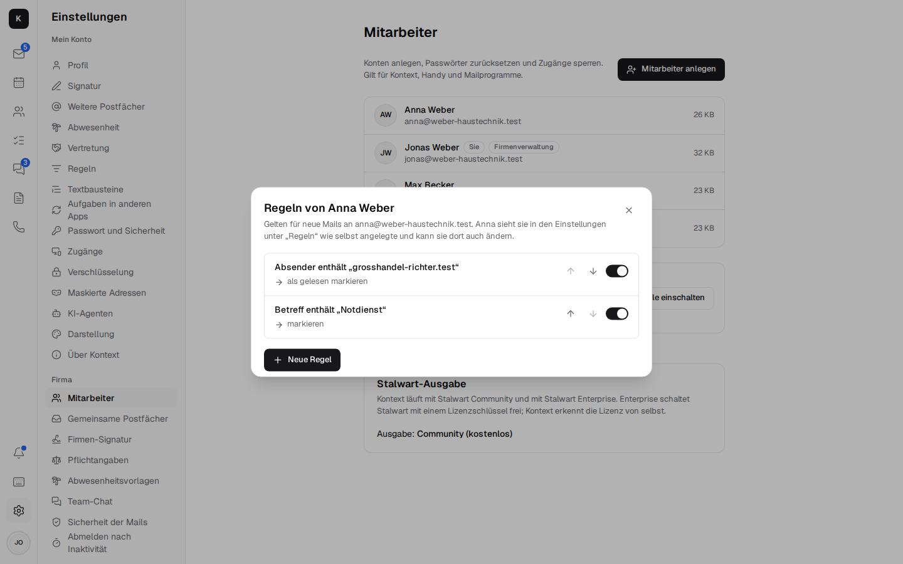
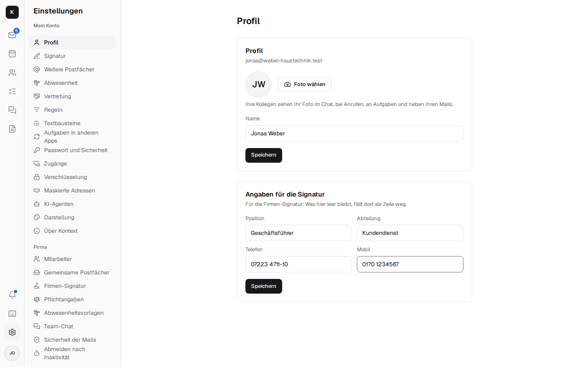
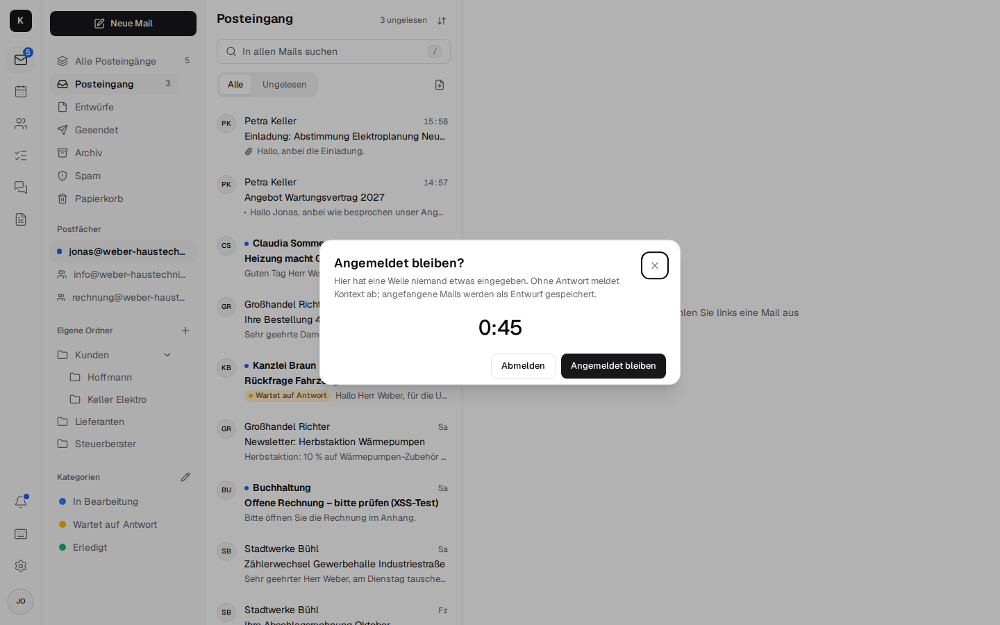

# Company admin and migration { #firmenverwaltung-und-umzug }

Under *Settings → Company* the boss (or the office manager) runs the company themselves – without
Stalwart's admin interface and without IT skills.

## Employees and mailboxes { #mitarbeiter-und-postfacher }

- **Add employees** with a starting password, reset the password and the sign-in with a code,
  **block access** (mail keeps arriving), further addresses such as buchhaltung@.
- **Stalwart Community or Enterprise:** Kontext runs with both. *Employees* shows which edition
  the server has; Kontext detects an Enterprise license by itself
  ([installation](installation.md#stalwart-enterprise)). With a license it also shows how many
  mailboxes are in use (such as "12 of 25 mailboxes in use", shared mailboxes count too), until
  when it is valid and for which domain; from 90 % in use or 30 days before the end it warns.
- **Shared mailboxes** with rights per person: no access, read only, read and send; rules of
  their own per mailbox.
- **Out of office for colleagues** (during illness, for example) with a stand-in named in the reply.
- **Out-of-office templates** under *Settings → Company → Out-of-office templates*: a few texts
  with a title ("Holiday", "Ill") that everyone can pick for their out-of-office reply, and the
  company admin under "Set out of office". Kontext fills in `{Name}`, `{Bis}` (the last day) and
  `{Vertretung}` (the stand-in); a line whose value is missing (no end date, no stand-in) is left
  out. There are none at first.
- **Rules for employees:** *Rules* on the person's entry – for example “mail from the supplier into
  the Orders folder” for a new colleague. These are the same rules as under *Settings → Rules* of
  that person: she sees the ones the boss created there like her own and can change or delete
  them; the other way round, the boss sees hers. “Also apply to mail already in the Inbox” works on
  her inbox. Only someone allowed to open the company admin can get at other people's rules.

  

- **Company signature** for everyone at once, with `[Name]` and `[E-Mail]` per sender and
  `[Telefon]`, `[Mobil]`, `[Position]`, `[Abteilung]` (phone, mobile, position, department): each
  person enters those once under *Settings → Profile* (“Details for the signature”), and their
  signature is updated right away. A line whose detail is missing is left out – nobody has
  “Mobile:” without a number.

  

- **Legal footer** under *Settings → Company → Legal footer*: what has to be under every business
  mail – company name with legal form, registered office, register court and commercial register
  number, managing directors, VAT ID (§ 35a GmbHG, § 37a HGB). Once entered, Kontext adds the text
  under every mail of every employee when sending, also from shared mailboxes, encrypted and
  signed; unlike the signature, nobody can leave it out or change it. Plain text only, line breaks
  are kept; when it's empty (as it is at the start), Kontext adds nothing. Whoever sends from
  another mail program over IMAP and SMTP (on the phone, say) doesn't get it: Kontext can't add
  anything there.
- **Leaving:** block access, hand the mailbox over to a colleague, forward new mail and reply
  automatically – nothing is deleted.
- **Delete account** on the person's entry, with Stalwart Enterprise only: the dialog says for how
  many days it can still be restored ([Deleted accounts](#geloschte-konten)), or, while no
  retention is set, that it is gone for good with all mail, calendars, contacts and files. With
  Stalwart Community there is no deleting, only leaving: so nothing there is lost by one click.
  One's own account cannot be deleted.
- **Availability in the calendar**, switched on for everyone.
- **Team chat:** retention period; **telephony:** Fritzbox, who is rung, voicemail, opening hours
  ([Telephony](telephony.md)).
- **External recipients** (the “External” hint, off until switched on): mail from outside carries
  the “External” tag, and before sending or inviting outside, Kontext asks once
  ([Mail](mail.md#schreiben)). Counted as internal are your own domains and the **partner domains**
  entered here (one per line, the tax advisor's office, say).
- **Report phishing** under *Settings → Company → Email security*: one address, such as your own
  IT team's or your IT provider's. Once it is entered, every mail has **Report as phishing** under
  "More actions": Kontext sends the mail as an attachment (.eml, with all its headers) to this
  address, without a copy in "Sent", and moves it to spam. Empty (as it is at first), the item is
  not there.
- **Sign out after inactivity** under *Settings → Company → Sign out after inactivity*: for
  computers several people share (reception, front desk). The company admin picks a time – off
  (as it is at the start), 15 or 30 minutes, 1, 4 or 8 hours. If nobody has moved the mouse,
  clicked or typed for that long, Kontext asks “Stay signed in?” and counts down one minute (at
  most half the time for short times). Moving the mouse doesn't answer the question, only “Stay
  signed in” (or closing it) does. Without an answer, Kontext saves mails being written as drafts
  and signs out, back to the sign-in. Input in one tab counts for all tabs in the same browser, and
  so does a running call; if the browser was closed for longer than the time allows, Kontext signs
  out as soon as it is opened again. Someone who only writes in *Documents* is asked as well:
  Kontext doesn't see input inside its own frame. This applies to the web app; mail programs over
  IMAP and calendar apps over CalDAV stay signed in.

  

- **S/MIME authorities** under *Settings → Company → S/MIME authorities*: certificates of
  authorities the company trusts for S/MIME, in addition to Mozilla's list – for example the root
  of a state administration or a chamber (.cer, .crt, .pem). Each is listed with its name, issuer,
  validity and fingerprint and can be removed again
  ([Encryption](encryption.md#baustein-4-vertraulich-senden-fur-alle-empfanger)).
- **Check security:** SPF, DMARC, MTA-STS, TLS-RPT, DANE and HTTPS of your own domain
  ([Encryption](encryption.md#baustein-1-grundschutz-unsichtbar-fur-alles)).
- **Encrypt when sending** under *Settings → Company → Sicherheit der Mails*: a switch with
  which Stalwart itself encrypts mail to recipients outside the company when it knows their key,
  and the list of those keys – pasted, looked up by Stalwart (Web Key Directory, keys.openpgp.org)
  or learnt from received mails; each can be removed
  ([Encryption](encryption.md#verschlusseln-durch-stalwart)).
- **AI spam filter** under *Settings → Company → Email security* (only with Stalwart
  Enterprise; with Community only a hint is shown there): provider (Anthropic, OpenAI, Google
  Gemini or your own Ollama server), model, API key – or the one of the assistant in the chat –
  and whether the verdict counts in the spam score or is only observed. Stalwart asks the model
  about the mails its filter is unsure of; Kontext shows the verdict when reading
  ([Mail](mail.md#sicherheit)). What goes to the provider is described under
  [Installation → AI spam filter](installation.md#ki-spamfilter).
- **Backup:** where the backup goes, how the last run went, how full the storage is, the time of
  the nightly backup and “Back up now”, plus the log. For this, the units must be set up on the
  server ([Installation → Backups](installation.md#5-backups)); otherwise it says “Control isn’t
  set up on the server”.
- **Server health** (Stalwart Enterprise only) under *Settings → Company → Server health*: for the
  last 24 hours or 7 days, how many mails arrived, were filed as spam, were sent or turned out
  undeliverable, with a small chart per hour or day, failed sign-ins (and how many addresses
  Stalwart blocked for them), what waits in the queue and how much storage the mailboxes take.
  Below, the **delivery problems**: mails to recipients outside that did not arrive, with the
  other server's answer ("550 5.1.1 User unknown") and whether Stalwart gave up or tries again.
  For this, Stalwart has to record metrics and deliveries
  ([Installation](installation.md#serverzustand)); with Community the entry is missing.
- **Logo and templates** (Stalwart Enterprise only) under *Settings → Company → Logo and
  templates*: Stalwart sends a few mails itself – the **reminder by mail** for an appointment and
  mails about invitations when someone invites from a phone or a calendar program (CalDAV) or answers in the calendar. They then
  carry the **company logo** instead of Stalwart's (PNG, JPEG, GIF, WebP, ICO or SVG up to 1 MB;
  every mail program shows PNG), and both mails can be designed with an **HTML template of your
  own**. Without one Stalwart uses its built-in template; the editor then starts with Kontext's
  template in the app's style, in German or English (this only affects fixed texts such as the
  note under the reminder – Stalwart fills in the other texts in the recipient's language).
  Kontext checks the template the way Stalwart reads it and shows it with an example appointment
  before it applies; “Use Stalwart's template” deletes your own again. With Community the entry is
  missing ([how it works](architecture.md#logo-und-vorlagen)).
- **Deleted items** (only with Stalwart Enterprise): under *Backup* the company admin sets for how
  many days Stalwart keeps what was deleted for good – 0 (the start) keeps nothing; the period
  applies to what is deleted from then on. That long, everyone brings back their own mails under
  *Settings → Deleted items* ([Mail](mail.md#ordnen-und-finden)). On an employee's entry and on
  every shared mailbox, **Deleted items** opens the same list for that account: restore (into the
  inbox) or delete for good. The Kontext server needs the rights `sysArchivedItem…` and
  `sysDataRetention…` for it, which the [setup command](installation.md#einrichtungsbefehl)
  grants. With the Community edition neither is there.

### Deleted accounts { #geloschte-konten }

Only with Stalwart Enterprise ([installation](installation.md#stalwart-enterprise)); with
Community the section is missing. With a license Stalwart keeps a deleted account for a while,
with its mail, calendars and files, and only then deletes it for good. *Employees → Deleted
accounts* has:

- **Keep for (days):** how long Stalwart keeps deleted accounts (in Stalwart
  `archiveDeletedAccountsFor` under *Data Retention*). At first 0: even with a license Stalwart
  then deletes for good at once. A new time applies to accounts deleted after it.
- **the accounts still there**, with address, when deleted and when gone for good – also those
  deleted in Stalwart's interface, if they belong to the company's domains, and shared mailboxes.
- **Restore:** the account is back, with its mail, calendars, contacts and files. Stalwart creates
  it again with only name and domain; Kontext gives a person a new password (shown once) and
  their shared mailboxes back, as far as they still exist. The name, further addresses, the
  right for the company admin and a blocked access are entered again afterwards; folders the
  person had shared are shared again.

## Sign-in with company account (SSO) { #sso }

Only with [Stalwart Enterprise](installation.md#stalwart-enterprise); in the Community edition
the entry is missing. Under *Settings → Company → Sign-in with company account (SSO)* the
employees of a domain sign in with the company's account – Microsoft Entra ID, Google Workspace,
Keycloak or another OpenID Connect provider – instead of a password for Kontext. The steps for
Entra ID are in the [installation guide](installation.md#sso-entra-id).

- **Provider:** issuer URL, client ID and secret of the app registered for Kontext at the provider
  (with the redirect URL shown), the scopes, the audience of the tokens (`aud`, empty means the
  client ID) and which claims carry address, name and groups. For providers whose access tokens
  are no JWTs (Google), choose “Ask the provider (UserInfo)”. **Test connection** checks that the
  provider answers and that Stalwart sends the sign-in for each domain to it.
- **Domains:** per domain *Sign-in with company account* and *Accounts over SCIM*. With the
  company account, Stalwart **no longer takes passwords** for the domain – not in mail programs
  either; app passwords work there, which Stalwart still checks before the directory. Whoever
  signs in for the first time gets their account by themselves, unless SCIM is on.
- **Signing in:** enter the address on the sign-in page; if it belongs to such a domain, the
  password field disappears and **Continue with company account** goes to the provider and back.
- **Accounts over SCIM:** the provider creates the accounts itself, changes names and addresses
  and locks those who leave. The card shows the **SCIM endpoint** (`https://<Kontext>/scim/v2`)
  and creates the **token** for it, shown only once; a new one replaces the old. In the employee
  list these accounts carry the mark **SCIM**; name, addresses and lock cannot be changed there,
  because the next sync would set them back. Accounts with the company account have no “Reset
  password”. Deleting over SCIM works because the setup command gives the role
  `Kontext-Server` the right `sysAccountDestroy`; on an older server only after it has run once
  more, until then the provider only locks.
- **Remove provider** releases the domains; whoever only had the company account then needs a
  password (*Reset password*).

## Moving to Kontext { #umzug-nach-kontext }

Under *Settings → Company → Migration* the boss fetches an employee's data from the old system; a
migration can safely be repeated, duplicates are skipped.

| From | How | What comes along |
| --- | --- | --- |
| **Gmail, GMX, WEB.DE, Telekom, IONOS, STRATO, your own server** | IMAP with an (app) password, synced every 15 minutes until the migration is finished | mail with folders or labels and keywords |
| **Microsoft 365** | an app in the company's Microsoft account (Graph) | mail with folders and Outlook categories, contacts, appointments and recurring events |
| **Outlook (PST file)** | upload | mail, contacts, appointments |
| **Google export** | upload vCard and iCalendar | contacts and calendars |

Whoever wants to keep their old address for good connects it as a
[further mailbox](mail.md#weitere-postfacher-gmail-gmx-webde-co).

Setup: [Installation → Switching on the company admin](installation.md#firmenverwaltung-einschalten)
and [Migration](installation.md#umzug). Technical details: [Architecture → Company admin](architecture.md#firmenverwaltung)
and [Migration](architecture.md#umzug).
