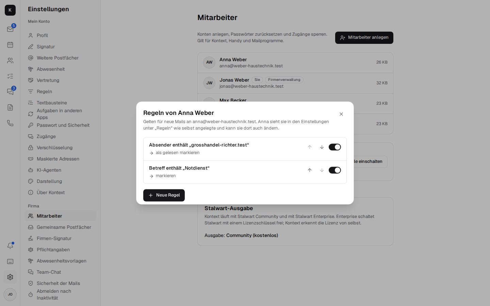
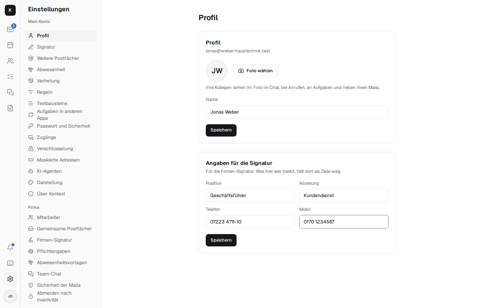
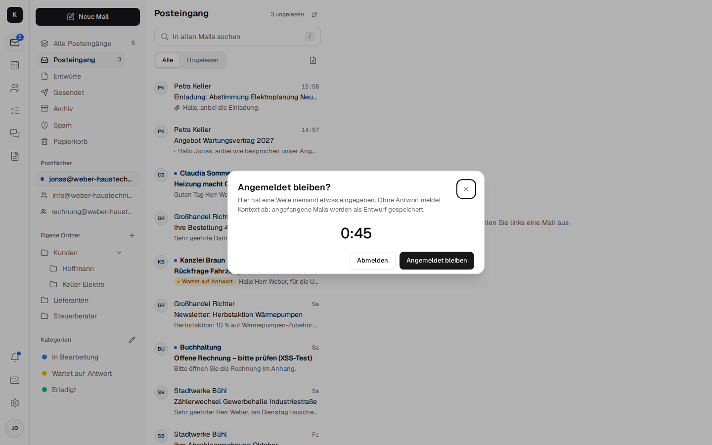

# Firmenverwaltung und Umzug

Unter *Einstellungen → Firma* verwaltet der Chef (oder die Büroleitung) die Firma selbst – ohne
Stalwarts Admin-Oberfläche und ohne IT-Kenntnisse.

## Mitarbeiter und Postfächer

- **Mitarbeiter anlegen** mit Startpasswort, Passwort und Anmeldung mit Code zurücksetzen,
  **Zugang sperren** (Mails kommen weiter an), weitere Adressen wie buchhaltung@.
- **Stalwart Community oder Enterprise:** Kontext läuft mit beiden. Unter *Mitarbeiter* steht,
  welche Ausgabe der Server hat; eine Enterprise-Lizenz erkennt Kontext von selbst
  ([Installation](installation.md#stalwart-enterprise)).
- **Gemeinsame Postfächer** mit Rechten je Person: kein Zugriff, nur lesen, lesen und senden;
  eigene Regeln je Postfach.
- **Abwesenheit für Kollegen** (etwa bei Krankheit) mit Vertretung in der Antwort.
- **Abwesenheitsvorlagen** unter *Einstellungen → Firma → Abwesenheitsvorlagen*: ein paar Texte
  mit Titel („Urlaub“, „Krank“), die jede Person für ihre Abwesenheitsnotiz auswählen kann, und die
  Firmenverwaltung bei „Abwesenheit eintragen“. `{Name}`, `{Bis}` und `{Vertretung}` setzt Kontext
  dabei ein; eine Zeile, deren Angabe fehlt (kein Enddatum, keine Vertretung), fällt weg. Zu Beginn
  gibt es keine.
- **Regeln für Mitarbeiter:** am Eintrag der Person *Regeln* – etwa „Mails vom Lieferanten in den
  Ordner Bestellungen“ für eine neue Kollegin. Es sind dieselben Regeln wie unter
  *Einstellungen → Regeln* der Person: Sie sieht die vom Chef angelegten dort wie ihre eigenen
  und kann sie ändern oder löschen; umgekehrt sieht der Chef ihre eigenen. „Auch auf die Mails
  anwenden“ wirkt auf ihren Posteingang. Nur wer die Firmenverwaltung öffnen darf, kommt an
  die Regeln anderer.

  

- **Firmen-Signatur** für alle auf einmal, mit `[Name]` und `[E-Mail]` je Absender und
  `[Telefon]`, `[Mobil]`, `[Position]`, `[Abteilung]`: die trägt jede Person einmal unter
  *Einstellungen → Profil* ein („Angaben für die Signatur“), und ihre Signatur ist sofort
  aktualisiert. Eine Zeile, deren Angabe fehlt, fällt weg – niemand hat „Mobil:“ ohne Nummer.

  

- **Pflichtangaben** unter *Einstellungen → Firma → Pflichtangaben*: was unter jeder
  geschäftlichen Mail stehen muss – Firma mit Rechtsform, Sitz, Registergericht und
  Handelsregisternummer, Geschäftsführer, USt-IdNr. (§ 35a GmbHG, § 37a HGB). Einmal eingetragen,
  setzt Kontext den Text beim Senden unter jede Mail aller Mitarbeiter, auch aus gemeinsamen
  Postfächern, verschlüsselt und signiert; anders als die Signatur kann ihn niemand weglassen oder
  ändern. Nur Text, Zeilenumbrüche bleiben; leer (so ist es zu Beginn) fügt Kontext nichts an.
  Wer mit einem anderen Mailprogramm über IMAP und SMTP sendet (etwa am Handy), bekommt ihn nicht:
  dort kann Kontext nichts anfügen.
- **Austritt:** Zugang sperren, Postfach einer Kollegin übergeben, neue Mails weiterleiten und
  automatisch antworten – gelöscht wird nichts.
- **Verfügbarkeit im Kalender** für alle einschalten.
- **Team-Chat:** Aufbewahrungsfrist; **Telefonie:** Fritzbox, wer klingelt, Mailbox,
  Öffnungszeiten ([Telefonie](telephony.md)).
- **Externe Empfänger** (Hinweis „Extern“, aus bis zum Einschalten): Mails von außerhalb tragen
  die Marke „Extern“, und vor dem Senden oder Einladen nach außen fragt Kontext einmal nach
  ([Mail](mail.md#schreiben)). Als intern gelten die eigenen Domains und die **Partner-Domains**,
  die hier eingetragen werden (eine je Zeile, etwa das Steuerbüro).
- **Phishing melden** unter *Einstellungen → Firma → Sicherheit der Mails*: eine Adresse, etwa die
  der eigenen IT oder des IT-Dienstleisters. Ist sie eingetragen, steht bei jeder Mail unter
  „Weitere Aktionen“ **Als Phishing melden**: Kontext schickt die Mail als Anhang (.eml, mit allen
  Kopfzeilen) an diese Adresse, ohne Kopie unter „Gesendet“, und verschiebt sie in den Spam. Leer
  (so ist es zu Beginn) gibt es den Punkt nicht.
- **Abmelden nach Inaktivität** unter *Einstellungen → Firma → Abmelden nach Inaktivität*: für
  Rechner, die mehrere nutzen (Empfang, Anmeldung). Die Firmenverwaltung wählt eine Zeit – aus
  (so ist es zu Beginn), 15 oder 30 Minuten, 1, 4 oder 8 Stunden. Hat so lange niemand die Maus
  bewegt, geklickt oder getippt, fragt Kontext „Angemeldet bleiben?“ und zählt eine Minute
  herunter (bei kurzen Zeiten höchstens die Hälfte). Mausbewegen beantwortet die Frage nicht, nur
  „Angemeldet bleiben“ (oder Schließen). Ohne Antwort speichert Kontext angefangene Mails als
  Entwurf und meldet ab, zurück zur Anmeldung. Eine Eingabe in einem Tab zählt für alle Tabs im
  selben Browser, ein laufender Anruf ebenso; war der Browser länger zu, als die Zeit erlaubt,
  meldet Kontext beim nächsten Öffnen gleich ab. Wer nur in *Dokumente* schreibt, wird ebenfalls
  gefragt: Eingaben in deren eigenem Rahmen sieht Kontext nicht. Gilt für die Web-App;
  Mailprogramme über IMAP und Kalender-Apps über CalDAV bleiben angemeldet.

  

- **S/MIME-Stellen** unter *Einstellungen → Firma → S/MIME-Stellen*: Zertifikate von Stellen,
  denen die Firma bei S/MIME vertraut, zusätzlich zu Mozillas Liste – etwa die Wurzel einer
  Landesverwaltung oder einer Kammer (.cer, .crt, .pem). Jede steht mit Name, Aussteller,
  Gültigkeit und Fingerabdruck da und lässt sich wieder entfernen
  ([Verschlüsselung](encryption.md#baustein-4-vertraulich-senden-fur-alle-empfanger)).
- **Sicherheit prüfen:** SPF, DMARC, MTA-STS, TLS-RPT, DANE und HTTPS der eigenen Domain
  ([Verschlüsselung](encryption.md#baustein-1-grundschutz-unsichtbar-fur-alles)).
- **Beim Versand verschlüsseln** unter *Einstellungen → Firma → Sicherheit der Mails*: ein
  Schalter, mit dem Stalwart Mails an Empfänger außerhalb der Firma selbst verschlüsselt, wenn es
  deren Schlüssel kennt, und die Liste dieser Schlüssel – eingefügt, von Stalwart gesucht (Web Key
  Directory, keys.openpgp.org) oder aus empfangenen Mails gelernt; jeder lässt sich entfernen
  ([Verschlüsselung](encryption.md#verschlusseln-durch-stalwart)).
- **Datensicherung:** wohin gesichert wird, wie der letzte Lauf ausging, wie voll der Speicher
  ist, die Uhrzeit der nächtlichen Sicherung und „Jetzt sichern“, dazu das Protokoll. Dafür
  müssen auf dem Server die Units eingerichtet sein
  ([Installation → Backups](installation.md#5-backups)); sonst steht dort „Steuerung auf dem
  Server nicht eingerichtet“.

## Anmeldung über Firmenkonto (SSO) { #sso }

Nur mit [Stalwart Enterprise](installation.md#stalwart-enterprise); in der Community-Ausgabe fehlt
der Eintrag. Unter *Einstellungen → Firma → Anmeldung über Firmenkonto (SSO)* melden sich die
Mitarbeiter einer Domain mit dem Konto der Firma an – Microsoft Entra ID, Google Workspace,
Keycloak oder ein anderer OpenID-Connect-Anbieter – statt mit einem Passwort für Kontext. Die
Schritte für Entra ID stehen in der [Installation](installation.md#sso-entra-id).

- **Anbieter:** Aussteller-URL, Client-ID und -Secret der App, die beim Anbieter für Kontext
  registriert ist (mit der angezeigten Weiterleitungs-URL), die Scopes, die Zielgruppe der Tokens
  (`aud`, leer heißt Client-ID) und welche Ansprüche Adresse, Name und Gruppen tragen. Bei
  Anbietern, deren Zugriffstokens keine JWTs sind (Google), „Beim Anbieter nachfragen
  (UserInfo)“ wählen. **Verbindung testen** prüft, ob der Anbieter antwortet und ob Stalwart die
  Anmeldung für jede Domain zu ihm schickt.
- **Domains:** je Domain *Anmeldung über Firmenkonto* und *Konten über SCIM*. Mit dem Firmenkonto
  nimmt Stalwart für die Domain **keine Passwörter mehr an** – auch nicht in Mailprogrammen; dort
  gelten App-Passwörter, die bei Stalwart weiter vor dem Verzeichnis geprüft werden. Wer sich zum
  ersten Mal anmeldet, bekommt sein Konto von selbst, es sei denn, SCIM ist an.
- **Anmelden:** Auf der Anmeldeseite die Adresse eingeben; gehört sie zu einer solchen Domain,
  verschwindet das Passwortfeld und **Weiter mit Firmenkonto** führt zum Anbieter und zurück.
- **Konten über SCIM:** Der Anbieter legt die Konten selbst an, ändert Namen und Adressen und
  sperrt Ausgeschiedene. Die Karte zeigt den **SCIM-Endpunkt** (`https://<Kontext>/scim/v2`) und
  erzeugt das **Token** dafür, das nur einmal angezeigt wird; ein neues ersetzt das alte. In der
  Mitarbeiterliste tragen diese Konten die Marke **SCIM**; Name, Adressen und Sperre sind dort
  nicht änderbar, weil der nächste Abgleich sie zurücksetzen würde. Bei Konten mit Firmenkonto
  fehlt „Passwort zurücksetzen“. Löschen über SCIM geht nur, wenn die Rolle `Kontext-Server` das
  Recht `sysAccountDestroy` hat (von Haus aus nicht): Sonst sperrt der Anbieter, gelöscht wird in
  Stalwart.
- **Anbieter entfernen** gibt die Domains frei; wer nur das Firmenkonto hatte, braucht dann ein
  Passwort (*Passwort zurücksetzen*).

## Umzug nach Kontext

Unter *Einstellungen → Firma → Umzug* holt der Chef die Daten eines Mitarbeiters aus dem alten
System; ein Umzug lässt sich gefahrlos wiederholen, Doppeltes wird übersprungen.

| Von | Wie | Was kommt mit |
| --- | --- | --- |
| **Gmail, GMX, WEB.DE, Telekom, IONOS, STRATO, eigener Server** | IMAP mit (App-)Passwort, abgeglichen alle 15 Minuten bis zum Abschluss | Mails mit Ordnern bzw. Labels und Schlagworten |
| **Microsoft 365** | eine App im Microsoft-Konto der Firma (Graph) | Mails mit Ordnern und Outlook-Kategorien, Kontakte, Termine und Serien |
| **Outlook (PST-Datei)** | hochladen | Mails, Kontakte, Termine |
| **Google-Export** | vCard und iCalendar hochladen | Kontakte und Kalender |

Wer seine alte Adresse dauerhaft behalten will, verbindet sie als
[weiteres Postfach](mail.md#weitere-postfacher-gmail-gmx-webde-co).

Einrichtung: [Installation → Firmenverwaltung einschalten](installation.md#firmenverwaltung-einschalten)
und [Umzug](installation.md#umzug). Technik: [Architektur → Firmenverwaltung](architecture.md#firmenverwaltung)
und [Umzug](architecture.md#umzug).
