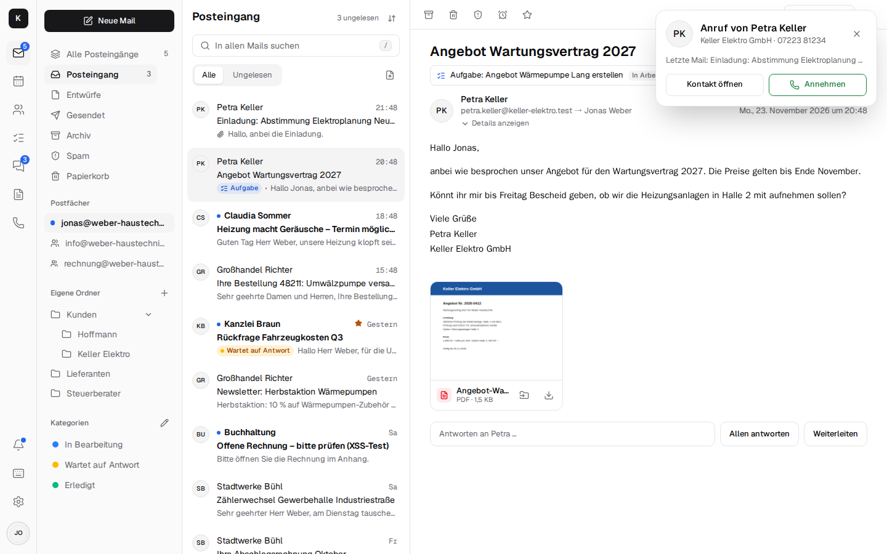
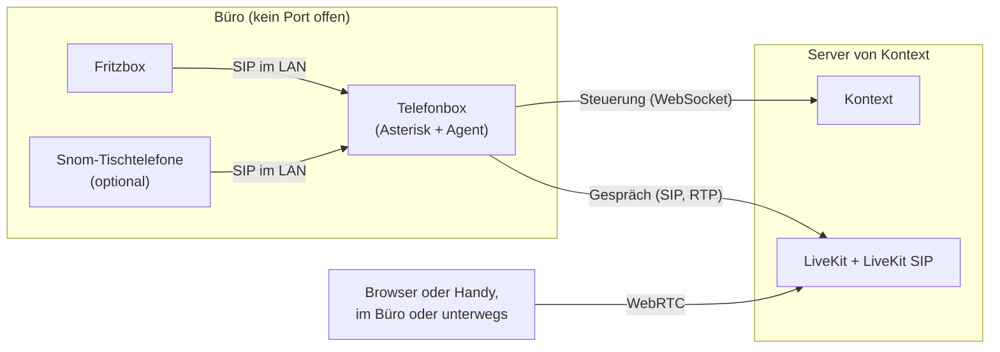

# Telefonie (CTI) mit der Fritzbox

Kontext verbindet das Firmentelefon mit Mail, Kontakten und Kalender (**CTI**, Computer Telephony
Integration): Ruft ein Kunde an, zeigt Kontext sofort, wer es ist – Kontakt, Firma, letzte Mail,
nächster Termin – und man nimmt im Browser an, am Rechner oder am Handy. Angerufen wird mit einem
Klick am Kontakt. Die Fritzbox bleibt am Anschluss, die Nummern und die Telefone an der Fritzbox
bleiben, wie sie sind; eine kleine **Telefonbox** im Büro meldet sich an der Fritzbox als
IP-Telefon an und verbindet sie mit Kontext. Keine Telefonanlage aus der Cloud, keine Kosten pro Nebenstelle.

!!! note "Im Test"
    Die Telefonie läuft beim ersten Kunden im Test. Rückmeldungen gern als
    [Issue](https://github.com/Speicherstadt/kontext/issues).

## Was man damit tut

- **Anruf mit Kontext:** Bei den Personen, die klingeln sollen, erscheint eine Karte mit Name,
  Firma, letzter Mail und nächstem Termin und „Annehmen“ – auch als Benachrichtigung auf dem
  Gerät, wenn Kontext zu ist. Wer eine Nummer nicht im Adressbuch hat, sieht die Nummer.
- **Annehmen im Browser oder am Tischtelefon:** Wer zuerst abnimmt, hat den Anruf. Kontext ist
  dabei ein Softphone mit Mikrofon und Lautsprecher (WebRTC); das Gespräch bleibt offen, während
  man zwischen Mail, Kalender und Chat wechselt.
- **Anrufen** aus jedem Kontakt, aus der Seitenleiste neben einer Mail oder auf der Seite
  *Telefon*; ein Tastenfeld schickt Töne für Sprachmenüs (DTMF).
- **Anrufliste** mit angenommenen, verpassten und abgewiesenen Anrufen, Notiz am Anruf und
  „Zurückrufen“.
- **Rückruf als Aufgabe:** Ein verpasster Anruf legt „Zurückrufen: …“ auf dem gewählten Board an,
  fällig heute; sobald jemand mit der Nummer gesprochen hat, hakt sich die Aufgabe selbst ab.

## Mailbox, Öffnungszeiten, Sprachmenü

- **Mailbox:** Nimmt niemand ab, spielt die Box die Ansage und nimmt eine Nachricht auf (bis zu
  zwei Minuten). Sie kommt als **Mail mit der Aufnahme** in das gewählte Postfach und lässt sich
  am Anruf abspielen. Ansagen spricht man direkt im Browser ein oder lädt sie hoch.
- **Öffnungszeiten** mit Mittagspause, geschlossenen Tagen und den Feiertagen des eigenen Bundeslands mit einem Klick:
  Außerhalb klingelt nichts, Anrufer hören die Ansage für „geschlossen“ und können eine Nachricht
  hinterlassen. Das prüft die Box selbst, auch wenn Kontext gerade nicht erreichbar ist.
- **Sprachmenü:** „Für den Kundendienst drücken Sie die 1 …“ – jede Taste klingelt bei ihren
  Leuten (das Thema steht am Anruf) oder führt auf die Mailbox.
- **Sperrliste:** „Sperren“ in der Anrufliste, auf Wunsch alle unterdrückten Nummern; die Box
  weist sie ab, bevor etwas klingelt.

## Im Gespräch

- **Weitervermitteln** an eine Kollegin (es klingelt bei ihr, man geht, sobald sie dran ist), an
  eine beliebige Nummer oder an ein Telefon der Fritzbox (`**610`).
- **Halten, Rückfrage, Dreierkonferenz:** Wartemusik für den Anrufer, eine Kollegin erst fragen,
  dann den Anrufer zurückholen und zu dritt sprechen – oder die beiden allein lassen.
- **Gespräche aufnehmen**, wenn die Firma es erlaubt: Die Box spielt dem Anrufer vorher einen
  Hinweis (Einverständnis nach § 201 StGB); die Aufnahme liegt beim Anruf, sie wird nicht gemailt.

## Wer klingelt wann

- **Alle gleichzeitig oder der Reihe nach** (jede Person eine Weile, dann alle), dazu auf Wunsch
  ein **Handy**, das nach einer eingestellten Zeit mitklingelt.
- **Durchwahlen:** weitere Nummern des Anschlusses, jede klingelt bei ihren Leuten, die mit ihr
  auch anrufen.
- **Präsenz:** „telefoniert“ steht im Chat an der Person; mit *Bitte nicht stören* oder *Abwesend
  bis …* klingelt es bei den anderen (auch das eigene Tischtelefon bleibt still).

## Geräte im Büro

- **Snom-Tischtelefone** melden sich an der Box an und holen sich ihre Einstellungen selbst
  (Provisionierung): Sie klingeln zusammen mit Kontext, erreichen sich per Kurzwahl und lassen
  sich beim Weitervermitteln wählen.
- **Türsprechstelle** der Fritzbox: Es klingelt in Kontext mit „Tür öffnen“ und „Sprechen“.
- **Fax als PDF-Mail:** Eine Nummer des Anschlusses nimmt Faxe an; jedes kommt als PDF in das
  gewählte Postfach.
- **Notruf** (110, 112) und Kurzwahlen gehen direkt über die Fritzbox; fällt das Internet aus,
  bleiben die Telefone an der Fritzbox.

## Auswertung

Anrufe der letzten 30 Tage: wie viele, wie schnell angenommen, wann Anrufe verpasst wurden
(Wochentag × Stunde), außerhalb der Öffnungszeiten, Nachrichten und wer angenommen hat.

## So funktioniert es

**Warum muss beim Kunden kein Port offen sein?** Jede Verbindung baut die Box von innen nach außen
auf, so wie ein Browser eine Website öffnet. Die Fritzbox lässt Antworten auf eine Verbindung, die
von innen kam, wieder herein. Über die WebSocket-Verbindung zu Kontext, die die Box ständig offen
hält, kommen auch die Befehle zu ihr („annehmen“, „wählen“); Kontext muss die Box also nie von
außen erreichen. Für ein Gespräch wählt die Box LiveKit SIP auf dem Server an und schickt den Ton
zuerst hinaus; der Server antwortet an dieselbe Adresse. Offene Ports gibt es nur auf dem Server.

**Wie geht das von überall?** Das Gespräch findet in einem Raum auf dem Server statt: Die Box holt
den Anrufer hinein, der Browser oder das Handy tritt demselben Raum bei. Beide verbinden sich nur
mit dem Server, nicht miteinander – deshalb ist egal, ob man im Büro, zu Hause oder unterwegs ist.

**Meldet sich die Box für jede Person an der Fritzbox an?** Nein, einmal je Rufnummer. Für die
Fritzbox ist die Box ein einziges IP-Telefon; wer klingelt, wer annimmt, Weitervermitteln an
Kollegen, Halten und Konferenz regelt Kontext selbst. Ein weiteres IP-Telefon in der Fritzbox
braucht es nur für eine weitere Nummer (eine Durchwahl), damit die Box sieht, welche Nummer
angerufen wurde.

**Braucht man Tischtelefone?** Nein. Kontext ist selbst das Telefon, im Browser mit Headset oder am
Handy. Tischtelefone (heute Snom) kommen dazu, wo jemand lieber einen Hörer in die Hand nimmt.

**Und Snom-Telefone, die schon an der Fritzbox hängen?** Die klingeln weiter, weil die Fritzbox alle
ihre Telefone klingeln lässt; Kontext sieht dann aber nur „Am Telefon angenommen“ und nicht, wer
abgenommen hat, und kann nicht an sie weitervermitteln. Besser zieht man sie auf die Box um (in
Kontext anlegen, in der Fritzbox löschen, siehe [Installation](installation.md#telefonie)): Dann
klingeln sie zusammen mit Kontext, erreichen sich per Kurzwahl, lassen sich beim Weitervermitteln
wählen, und ihre Anrufe stehen in der Liste. Läuft die Box nicht, bleiben sie still; Telefone
direkt an der Fritzbox (etwa DECT) klingeln weiter.

**Wie viele Gespräche gehen gleichzeitig?** So viele, wie der Anschluss nach draußen erlaubt – bei
vielen Anschlüssen zwei, bei Geschäftsanschlüssen oft mehr (das steht im Vertrag). Gespräche und
Weitervermitteln innerhalb von Kontext und zu den Tischtelefonen an der Box kosten keine Leitung.
Weitervermitteln an eine Nummer draußen oder an ein Telefon der Fritzbox und das Handy, das
mitklingelt, brauchen zwei freie Leitungen: die zum Anrufer und eine zweite.

**Geht es auch ohne Fritzbox?** Mit einem anderen Router, wenn er IP-Telefone annimmt (eine
eingebaute Telefonanlage hat); getestet ist bisher nur die Fritzbox. Die Türsprechstelle gibt es nur
mit der Fritzbox. Ohne Router mit Telefonanlage braucht es den SIP-Trunk direkt beim Anbieter, der
auf der Roadmap steht.

## Was es braucht

- eine **Fritzbox** am Anschluss (Telefonie → Telefoniegeräte → IP-Telefon „Kontext“);
- die **Telefonbox** im Büronetz: ein Container mit Asterisk und dem Box-Agent, auf einem
  gebrauchten Thin Client, einem Raspberry Pi, dem Firmenserver oder einem NAS mit Docker. Sie
  baut die Verbindung zu Kontext von innen auf, **beim Kunden ist kein Port offen**;
- auf dem Server **LiveKit** und **LiveKit SIP** (in `compose.yaml` mit dem Profil `calls`);
- **Tischtelefone nicht:** Ein Headset am Rechner oder das Handy reicht.

Einrichtung Schritt für Schritt: [Installation → Telefonie](installation.md#telefonie). Wie Box,
Asterisk, LiveKit SIP und Kontext zusammenspielen: [Architektur → Telefonie](architecture.md#telefonie).
Was als Nächstes kommt (SIP-Trunk direkt beim Anbieter, SIP über TLS, Warteschleife, weitere
Tischtelefone): [Roadmap](https://github.com/Speicherstadt/kontext/blob/main/ROADMAP.md).
